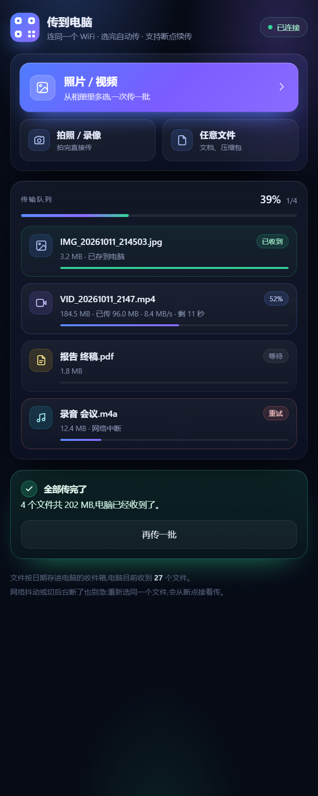

# 扫码传文件 · 手机向电脑的局域网直传

**一句话:手机扫个码,照片、视频、文件直接进电脑。不装 App、不走外网、不限大小。**


## 这个项目是什么

手机上往电脑传东西,常见办法都别扭:微信会压缩、云盘限速、数据线要找线。这个项目用电脑开一个
局域网 HTTP 服务,手机浏览器扫码打开就能选文件,点两下传完,文件直接落进电脑桌面的文件夹。

**它解决什么问题:** 大量照片/视频从手机快速进电脑,并且传过去的文件 AI(Codex)可以直接读取处理。

## 特性

- **扫码即用** —— 手机浏览器直接打开,支持 iOS / Android,不需要安装任何 App
- **三种入口** —— 相册多选、直接拍照/录像、任意文件(文档、压缩包……)
- **大文件友好** —— 4 MB 分片上传,自动重试;断网或切后台后重新选同一个文件可**从断点续传**
- **自动归档** —— 按日期建子文件夹,保留原始文件名(中文无压力),重名自动加序号
- **桌面端好用** —— 实时进度与速度、图片缩略图、**复制到剪贴板**(文件/图片两种格式)、
  在资源管理器定位、复制或移动到别处
- **安全** —— 链接带随机口令且每次启动更换;只在局域网内传输,不经过任何外网服务器

## 截图

| 电脑端 | 手机端 |
|---|---|
|  |  |

## 安装

**环境要求:** Windows 10 / 11 + Python 3.10+(官方安装包自带 tkinter)

```bash
pip install pillow qrcode
```

## 快速开始

1. **装依赖**(只需一次):`pip install pillow qrcode`
2. **启动**:双击 `启动扫码传文件.bat`,或命令行运行 `python lan_share.py`
3. **扫码**:手机连同一个 WiFi,用相机/微信扫窗口左边的二维码,在手机页面上选文件即可

> 首次运行 Windows 会弹防火墙提示,请勾选「专用网络」并允许,否则手机连不进来。

收到的文件默认在桌面的 `手机传过来的文件\` 文件夹里。

## 使用示例

**手机传照片:**

1. 打开手机页面,点「照片 / 视频」
2. 相册里多选,点完成 → 自动开始上传,能看到每个文件的百分比、速度、剩余时间
3. 电脑窗口「正在接收」实时走进度,传完自动出现在「已收到」,并选中显示缩略图

**在电脑上取用:**

- 选中文件 → 点「打开文件」直接用默认程序打开
- 点「复制到剪贴板」→ 到微信/Word/聊天窗口按 `Ctrl+V`(文件或图片都能粘)
- 点「在资源管理器里定位」→ 直接跳到文件所在位置
- 右键文件 → 复制路径 / 复制到… / 移动到…

**让 AI 处理:**

传完直接说「看看刚传的照片」「按内容分类并重命名」,Codex 会读桌面那个收件文件夹和
`_index.jsonl`,不需要你挑文件。

## 配置说明

程序运行后会在同目录生成 `设置.json`,也可以在窗口里改:

| 键 | 含义 | 默认 |
|---|---|---|
| `inbox` | 文件存到哪个文件夹 | 桌面\`手机传过来的文件` |
| `organize` | 收件箱内怎么整理:`date` 按日期 / `type` 按类型 / `none` 平铺 | `date` |
| `codex_sync` | 是否把收到的文件同步给 Codex | `true` |
| `codex_dir` | Codex 读取的文件夹(默认与收件箱相同,不产生第二份) | 同 `inbox` |

## 命令行参数

```bash
python lan_share.py --dir D:\手机传文件      # 指定收件箱
python lan_share.py --port 9000            # 指定端口(默认 8600,被占用会自动往后找)
python lan_share.py --organize type        # 按类型分:图片/视频/音频/文档/其他
python lan_share.py --no-gui               # 不开窗口,终端里打印二维码
python lan_share.py --open-browser         # 启动时在电脑上也打开一次页面
```

## 常见问题

**手机打不开页面?**

确认手机和电脑连同一个 WiFi。多半是防火墙,可手动加规则(管理员身份运行):

```
netsh advfirewall firewall add rule name="扫码传文件" dir=in action=allow protocol=TCP localport=8600
```

少数路由器开了「AP 隔离」,同一 WiFi 也互相不通,可让手机连电脑开的移动热点。

**端口被占用?** 程序会自动往后找可用端口,以窗口显示的地址为准。

**按钮点了没反应?** 程序会把异常写进同目录的 `错误.log` 并弹提示框,把日志发出来即可排查。

**传大视频安全吗?** 文件只在自己的局域网里走,不经过外网;链接带随机口令,每次启动更换。

## 工作原理

- 服务端基于 Python 标准库 `http.server.ThreadingHTTPServer`(多线程 + HTTP/1.1 长连接),
  上传用 `POST /s/<token>/api/chunk?id=..&offset=..` 的原始字节流,避免 multipart 解析,
  也不会把大文件读进内存。
- 上传会话 ID 由「文件名 + 大小 + 修改时间」哈希得到,所以**重新选同一个文件就能续传**。
- 桌面端不用 ttk 主题控件,整窗 Canvas 自绘:圆角/渐变由 Pillow 预渲染,
  文字与进度条直接画在 Canvas 上,并按屏幕 DPI 缩放。
- 复制到剪贴板同时写入 `CF_HDROP`(文件)与 `CF_DIB`(位图),粘到资源管理器或聊天窗口都行。

## 目录结构

| 文件 | 作用 |
|---|---|
| `lan_share.py` | 服务端:接收、分片、续传、索引、同步 |
| `ui_desktop.py` | 电脑端窗口(Canvas 自绘) |
| `page.html` | 手机端页面(无框架、无外链,可自行改样式) |
| `icon.ico` / `icon.png` | 应用图标(多尺寸 ico) |
| `使用说明.md` | 更详细的中文说明 |

## 许可

本项目使用 [MIT License](LICENSE)。
